# patent-docent

*An engine that reads one patent in depth and writes an X thread for general readers, with a human approval point before writing and before shipping.*

특허 한 건을 깊게 읽고, 일반 독자용 영어 X 스레드를 만드는 엔진입니다. 이름은 미술관 도슨트에서 왔습니다. 도슨트는 관람객을 미술사학자로 만들지 않습니다. 작품 앞의 10분을 만족스럽게 만듭니다.

이 엔진의 원칙은 「투자자의 질문에, 기술로 답한다」입니다. 답은 특허에 적힌 기술 근거로만 씁니다. 종목 추천 · 가격 전망 · 매수매도 함의는 쓰지 않습니다.

## 작동 방식

```mermaid
flowchart LR
    S[source<br/>원문 받기] --> R[read<br/>재료 명세 만들기]
    R --> CP1{{CP1<br/>사람이 재료 승인}}
    CP1 --> F[freeze<br/>재료 동결]
    F --> D[design<br/>스레드 설계]
    D --> FG[figures<br/>도면 고르기 · 렌더]
    FG --> C[compose<br/>펜이 초안 쓰기]
    C --> G[gate<br/>L0 · L1 · L2 검사]
    G -- 결함 --> C
    G --> P[probe<br/>독자 이해 측정]
    P --> CR[critique<br/>소견 · 새 눈 최종 판정]
    CR --> CP2{{CP2<br/>사람이 출하 승인}}
    CP2 --> SH[ship<br/>출하 묶음]
```



단계마다 런 작업장 `runs/<run-id>/` 안의 폴더 하나에 씁니다. 다음 단계는 앞 단계의 폴더를 읽습니다. 단계마다 입출력 계약이 `contracts/stages/*.yaml` 에 있습니다.

## 핵심 생각: 사람은 어디서 보나

LLM 이 일을 하고, 사람은 감독과 판단을 맡습니다. 그래서 사람이 보는 자리를 설계의 중심에 두었습니다.

1. **읽기와 쓰기를 나눕니다.** read 단계가 재료 명세를 만듭니다. 사람이 CP1 에서 그 재료를 승인하면, freeze 가 재료를 동결합니다. 쓰기는 그 뒤에만 시작합니다.
2. **펜은 재료를 고칠 수 없습니다.** 본문의 기술 주장은 모두 재료 항목 ID(`M<n>`)로 근거를 댑니다. 재료가 틀렸으면 펜은 read 로 반려합니다.
3. **게이트는 정답이 있는 것만 검사합니다.** L0 는 결정론 검사이고, L1 은 여러 레인의 다수결 대조이고, L2 는 자문입니다. 게이트는 결함과 지시문만 내고 글을 고치지 않습니다.
4. **마지막은 새 눈이 봅니다.** 점수와 수정 이력을 모르는 별도 심급이 최종 초안을 봅니다. 사람은 CP2 에서 출하를 승인합니다.

이 원칙의 정본은 헌장 [`docs/CHARTER.md`](docs/CHARTER.md)(D1 ~ D15)입니다. 공학 전개는 [`docs/SPEC.md`](docs/SPEC.md) 에 있습니다.

## 코드 지도

| 자리 | 내용 |
|---|---|
| `engine/stages/` | 단계 러너(source · read · freeze · design · figures · compose · gate · probe · critique · ship) |
| `engine/gate/` · `engine/probe/` · `engine/critique/` | 게이트 L0 · L1 · L2, 독자 이해 측정, 소견과 최종 판정 |
| `engine/pens/` · `engine/lanes/` | 펜 요청과 LLM 레인 왕복 |
| `reader/` | 독해층. 재료 명세 스키마와 결정론 검사. 자매 프로젝트와 나누는 이식 단위입니다([`reader/README.md`](reader/README.md)). |
| `contracts/` | 단계 계약 · 형식 수치 · 화행과 결함 어휘. 용어집은 [`contracts/glossary.md`](contracts/glossary.md) 입니다. |
| `ledgers/` | 앵커 · 회귀 표본 · 섀도 원장 |
| `tools/` | 런 구동기와 커밋 전 관문 7개 |
| `studio/` | 도면 렌더러(헤드리스 Chromium) |
| `tests/` | pytest 시험 |
| `docs/` | 헌장 · 스펙 · 재정 원장(`docs/decisions/`) · 감수 원문(`docs/lessons/`) |

## 돌리는 법

시험:

```sh
python3 -m pip install -r requirements-dev.txt
python3 -m pytest tests/ -q
```

런은 구동기 `tools/drive_partial_read.py` 로 명령 단위로 굴립니다. LLM 호출은 `claude -p` 로 합니다. 명령마다 하는 일은 [`tools/README-drive_partial_read.md`](tools/README-drive_partial_read.md) 에 있습니다.

## 상태

구동 명령 26개 · 시험 976개 · 커밋 전 관문 도구 7개입니다. 에이전트가 이 리포에서 일할 때 지킬 규약은 [`CLAUDE.md`](CLAUDE.md) 에 있습니다. 구현 이력은 [`docs/IMPLEMENTATION-HISTORY.md`](docs/IMPLEMENTATION-HISTORY.md) 에 있습니다.

사람이 어디서 보고 승인하는지를 설계의 중심에 둔 LLM 파이프라인의 실물 예시로 공개합니다.
